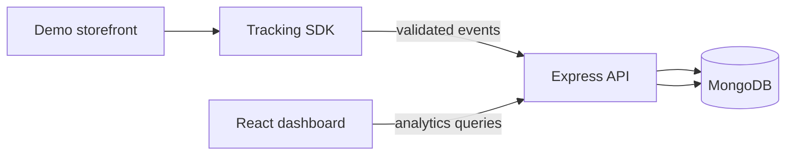

# SessionScope

Privacy-conscious session analytics for a demo storefront. Real browser page views and clicks are sent by a reusable tracker to an Express API, persisted in MongoDB, aggregated by the API, and displayed in the React dashboard.

## Architecture



## Stack

React 18, Vite, TypeScript, React Router, TanStack Query, Recharts, Express, Mongoose, MongoDB, Zod, Pino, Helmet, Vitest, React Testing Library.

## Features

- Page view and delegated click tracking with a cryptographically random persistent session ID, 30-minute inactivity timeout, normalized viewport coordinates, bounded queue/retries, duplicate initialization protection, and opt-out.
- Project-scoped ingestion with schema and size validation, unique event ID deduplication, origin allowlists, and per-IP rate limiting.
- MongoDB aggregation-backed overview, session summaries, chronological session details, event explorer, and click heatmap endpoints.
- Responsive overview, sessions and journey pages, heatmap fallback canvas, events explorer, project settings, installation guide, loading/error/empty states, and sidebar collapse.
- Demo storefront pages for landing, listing, products, cart, and non-payment checkout. The UI reports event batch acceptance from the SDK.
- Structured request logging, request IDs, security headers, readiness/health endpoints, graceful shutdown, OpenAPI entry point, and MongoDB TTL retention index.

## Prerequisites

Node.js 20+, npm 10+, and Docker Desktop (or MongoDB 7 locally). Atlas can be used instead of local MongoDB.

## Environment

Copy `.env.example` to `.env`. Key settings:


The Vite environment values are exposed to browser bundles; never place secrets in them.
Project settings writes are enabled without a key only in local development. In production, set a strong `ADMIN_API_KEY` on the API and call the origin-management endpoint from a trusted admin client with the `x-admin-key` header. This assignment does not include user login or a secure browser admin-token flow, so the dashboard intentionally cannot send that server secret.

## Local startup

```sh
cp .env.example .env
npm install
docker compose up -d mongo
npm run dev
```

Open the dashboard at http://localhost:5173 and the demo storefront at http://localhost:5174. The API is at http://localhost:4000. The API creates the default project on startup. To populate optional sample analytics, run `npm run seed` (only inserts when the project has no events). To try a clean dataset, use a new MongoDB database name in `MONGODB_URI`.

From PowerShell, replace the first line with `Copy-Item .env.example .env`.

## Verify the tracking flow

Open the demo storefront, navigate between pages, click buttons or product cards, and check the development indicator for accepted API batches. Then inspect Overview, Sessions, Events explorer, or Click heatmap in the dashboard. The heatmap uses normalized **viewport-relative** coordinates (0–1); page scrolling does not become document coordinates, so it shows where a click fell in the visible viewport rather than a fixed full-page position. Its stylized canvas is a fallback preview, not a screenshot of arbitrary external pages.

## API

Interactive API reference: http://localhost:4000/api/v1/docs

| Method | Endpoint | Description |
| --- | --- | --- |
| GET | `/api/v1/health`, `/api/v1/ready` | Liveness and Mongo readiness |
| POST | `/api/v1/events` | Single event or batch of up to 100 |
| GET | `/api/v1/projects` | Project configuration |
| PATCH | `/api/v1/projects/:projectId` | Update allowed origins |
| GET | `/api/v1/analytics/overview` | KPI, trends, pages, event categories |
| GET | `/api/v1/sessions` | Filtered and paginated session aggregates |
| GET | `/api/v1/sessions/:sessionId/events` | Chronological bounded event list |
| GET | `/api/v1/events` | Paginated event explorer data |
| GET | `/api/v1/heatmap/pages` | Pages with actual event/click counts |
| GET | `/api/v1/heatmap/clicks` | Actual normalized click coordinates for a page |

Analytics routes accept `projectId`; date-aware routes accept ISO `from` and `to`. Session listing also accepts `page`, `limit`, `search`, `pageUrl`, and `sort=events`. Heatmap clicks require `pageUrl`.

## MongoDB Atlas

Create a database user and database, allow only the development/deployment host IP ranges needed, and set the Atlas connection URI in `MONGODB_URI`. Do not commit credentials. Mongoose creates indexes at model initialization, including unique `(projectId,eventId)` and the query indexes. The TTL index deletes records based on server `receivedAt`; existing data is retained until its TTL expires when the configured duration changes. There is no separate migration runner; schema/index changes are applied by Mongoose on startup.

## Tests and builds

```sh
npm run typecheck
npm test
npm run build
```

Tests cover payload validation, normalized click bounds, SDK page-view delivery/session persistence/opt-out, and dashboard shell rendering. Mongo-backed integration and Playwright end-to-end coverage are not included yet; those require a test MongoDB lifecycle and browser automation setup. No live Atlas credentials were provided, so event persistence should be exercised with the local Mongo service before relying on a deployment.

## Deployment

1. Provision MongoDB Atlas and restrict network access to the API host.
2. Deploy `apps/api` to Render or another Node.js host with `MONGODB_URI`, `ALLOWED_ORIGINS`, `DEFAULT_PROJECT_ID`, and retention settings. Set the start command to `npm run start --workspace @sessionscope/api`; build with `npm install && npm run build`.
3. Deploy `apps/dashboard` and `apps/demo-storefront` as separate Vercel projects with root directory and workspace build configuration, set `VITE_API_URL`, `VITE_PROJECT_ID`, and (on dashboard) `VITE_TRACKER_URL`.
4. Add production dashboard/storefront origins to API CORS configuration and project allowed origins. Serve the tracker bundle at a stable HTTPS URL and update the installation snippet.
5. Verify health/readiness, send a demo event, then verify it appears in the dashboard. No deployment has been created or verified.

## Security and privacy decisions

The SDK excludes input values, password/email/telephone/number field content, keystrokes, and DOM snapshots. It omits URL query strings and fragments, strips query strings from referrers, records only a short non-email/non-phone label, and ignores opt-out and `[data-ss-ignore]`. It uses localStorage for the random session ID and last activity timestamp, expiring after 30 minutes idle. The project ID is public and is not authentication. Origin checks can be forged by non-browser clients; for meaningful public traffic add signed ingestion tokens or edge/WAF controls, bot filtering, and per-project quotas. Configure consent and retention to match applicable policies. Do not use this demo as regulated-data analytics.

## Limitations and operational work

- Date range filtering is available on overview and API queries; advanced cross-filtering, period-over-period comparison, and viewport-filter controls are not exposed in the current dashboard.
- The initial standalone tracker is bundled into the demo app's public directory; publish it to a dedicated static host for independent production installation. The dashboard preview is illustrative; arbitrary external pages may deny framing and are not embedded.
- Ingestion rate limits are in-memory and per API process. Use a shared limiter at scale. Event batching is small and bounded in browser memory; prolonged offline delivery may drop the oldest queued item.
- Mongo aggregation and indexes suit a small assignment dataset. High volume requires load testing, query budgets, rollups, backups, monitoring, and possibly partitioning/archival. Session summaries are computed at read time.
- Retention uses MongoDB TTL deletion, which is asynchronous. TTL expiry is not an exact deletion deadline.
- Integration/E2E, cross-browser, consent-manager integrations, account authentication, role-based access, and production deployment are future work.

## Screenshots

Add screenshots or a short GIF here after running the local apps.

## Repository commands

```sh
git init
git add .
git commit -m "Build SessionScope analytics platform"
git branch -M main
git remote add origin <your-repository-url>
git push -u origin main
```
